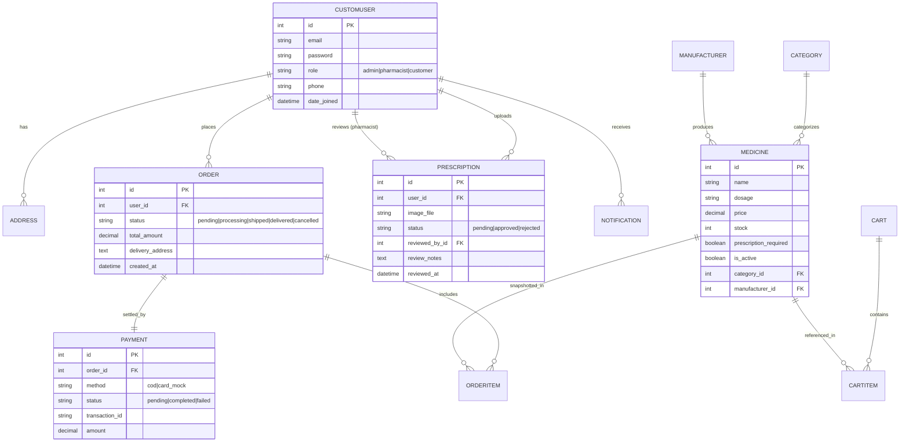

# ePharmacy – Online Pharmacy E-Commerce and Management System
## Academic Project Report & Engineering Documentation

**Course:** CSE 3206 – Software Engineering Sessional (22 Series)  
**Department:** Computer Science & Engineering (CSE)  
**Institution:** Rajshahi University of Engineering & Technology (RUET)  
**Target Course Outcomes:** CO4 (Modern Engineering Tools & Software Practices), PO12 (Life-Long Learning & Professional Ethics)  
**Project Classification:** Single-Pharmacy Web Application & Inventory Management System  

---

# Table of Contents
1. [Chapter 1: Introduction](#chapter-1-introduction)
2. [Chapter 2: Software Requirements Specification (SRS)](#chapter-2-software-requirements-specification-srs)
3. [Chapter 3: Software Development Life Cycle (SDLC)](#chapter-3-software-development-life-cycle-sdlc)
4. [Chapter 4: System Architecture and Design](#chapter-4-system-architecture-and-design)
5. [Chapter 5: Design Patterns](#chapter-5-design-patterns)
6. [Chapter 6: Software Testing](#chapter-6-software-testing)
7. [Chapter 7: Configuration Management Using Git and GitHub](#chapter-7-configuration-management-using-git-and-github)
8. [Chapter 8: Self-Directed Learning (New Tool: Swagger / OpenAPI)](#chapter-8-self-directed-learning-new-tool-swagger--openapi)
9. [Chapter 9: Challenges and Solutions](#chapter-9-challenges-and-solutions)
10. [Chapter 10: Project Evaluation and Future Improvements](#chapter-10-project-evaluation-and-future-improvements)
11. [Chapter 11: Reflection Essay (CO4 & PO12 Compliance)](#chapter-11-reflection-essay-co4--po12-compliance)
12. [Chapter 12: Chronological Learning Log](#chapter-12-chronological-learning-log)
13. [Chapter 13: Conclusion](#chapter-13-conclusion)

---

# Chapter 1: Introduction

## 1.1 Background
The retail pharmaceutical landscape in developing economies is heavily reliant on physical, counter-based transactions. Patients and caregivers frequently encounter operational frictions, including physical travel during health emergencies, lack of stock visibility across local medicine shops, and manual paper-based record-keeping that increases dispensing errors. 

The **ePharmacy** project was initiated to bridge this physical-digital gap by designing and implementing a dedicated, enterprise-grade web application for a **single licensed pharmacy establishment**. Rather than functioning as an unmoderated multi-vendor open marketplace, ePharmacy operates as a closed, unified digital dispensary owned, operated, and governed by a centralized **Super Admin**, with specialized operational portals for **Registered Pharmacists** and **General Consumers (Customers)**.

## 1.2 Problem Statement
Traditional brick-and-mortar pharmacy operations face critical software and logistical bottlenecks:
1. **Lack of Real-Time Inventory Visibility:** Customers travel to physical stores without prior confirmation of medicine availability, particularly for critical antibiotics, specialized cardiac therapies, and emergency medications.
2. **Prescription Verification Non-Compliance:** Over-the-counter dispensing of restricted prescription medications contributes to antimicrobial resistance and drug misuse. Physical pharmacies often lack structured, auditable verification records.
3. **Inventory Spoilage and Stockouts:** Manual inventory tracking leads to expired stock on shelves, unrecorded batch numbers, and stockouts of high-demand medications.
4. **Disjointed Order Processing:** Lack of an automated order lifecycle tracker leaves patients uncertain regarding preparation, verification, and dispatch timelines.

## 1.3 Motivation
The primary motivation behind ePharmacy is to engineer a secure, highly reliable, and accessible healthcare software system adhering to modern Software Development Life Cycle (SDLC) methodologies. By applying core Software Engineering principles—including Design Patterns, Test-Driven Development (TDD), automated Continuous Integration (CI), and strict Role-Based Access Control (RBAC)—this project demonstrates how academic software engineering theories translate into life-critical digital health solutions.

## 1.4 Objectives
The core objectives of the ePharmacy project are:
- **Digitalize Pharmacy Operations:** Centralize medicine catalog management, real-time inventory tracking, and sales reporting within a single administrative portal.
- **Enforce Medical-Legal Compliance:** Create a strict prescription upload and clinical verification pipeline ensuring prescription-required drugs cannot be dispensed without licensed pharmacist sign-off.
- **Deliver a Transparent Customer Experience:** Provide real-time medicine search, dosage information, cart management, flexible payment options, and a 4-stage visual order progress stepper.
- **Satisfy Academic & Professional Engineering Standards:** Fulfill the requirements of RUET CSE 3206 (CO4, PO12) through rigorous process modeling, architectural modeling, automated testing with mocks, Git configuration management, and self-directed tool mastery.

## 1.5 Scope
ePharmacy is explicitly engineered as a **Single-Pharmacy Enterprise Management and E-Commerce System**:
- **Administrative Governance:** The platform represents a single commercial pharmacy business entity owned and regulated by the Super Admin.
- **Internal Staff Operations:** Pharmacists are licensed staff members employed by this pharmacy who review customer prescriptions, verify drug contraindications, manage inventory batches, and process fulfillment.
- **Consumer Services:** Customers access the pharmacy's unified digital storefront to browse products, consult medical information, upload prescription files, place orders, and track fulfillment.
- **Exclusions:** The system intentionally excludes multi-vendor marketplace mechanics, third-party vendor onboarding, and competing merchant bids, preserving singular administrative and clinical liability.

## 1.6 Target Users
The system provides tailored interfaces and authorization levels for three distinct actor profiles:
1. **Super Admin:** Executive business owner and platform administrator responsible for system configuration, staff credentialing, catalog pricing oversight, financial analytics, and customer dispute resolution.
2. **Pharmacist:** Clinical staff member responsible for inspecting scanned doctor prescriptions, validating clinical dosage safety, recording clinical verification remarks, updating inventory stock, and executing order packaging.
3. **General User (Customer):** Patient or caregiver searching for medications, adding items to cart, submitting digital prescriptions, executing payments, and receiving home delivery or store collection.

## 1.7 Expected Outcomes
- A production-ready, responsive web application accessible across desktop and mobile browsers.
- Real-time stock decrement and atomic inventory locking during checkout.
- Zero-bypass prescription verification gates that prevent checkout of restricted items without prior approval.
- Complete unit and integration test suite with $\ge 70\%$ code coverage and mock isolation.
- Fully documented Git workflow with pull request reviews, merge conflict resolutions, and CI automation.

## 1.8 Limitations
- **Payment Gateway Integration:** In this academic milestone, monetary checkout is verified via an extensible Strategy Pattern sandbox (Mock Gateway) and Cash on Delivery; live third-party bank webhooks (e.g., live bKash/Nagad APIs) require commercial merchant credentials.
- **Physical Courier Telemetry:** Order dispatch tracking operates on a 4-stage discrete state machine rather than real-time GPS coordinates.
- **Regulatory Framework:** Prescriptions are uploaded as high-resolution image/PDF files; integration with national electronic health record (EHR) databases is subject to future government API availability.

---

# Chapter 2: Software Requirements Specification (SRS)

## 2.1 Functional Requirements (Grouped by 10 Core Modules)

```
┌────────────────────────────────────────────────────────────────────────┐
│                        CORE FUNCTIONAL MODULES                         │
├────────────────────────┬──────────────────────┬────────────────────────┤
│ M1: Auth & RBAC        │ M2: Medicine Catalog │ M3: Inventory Mgmt     │
│ M4: Cart & Checkout    │ M5: Order Processing │ M6: Prescription Queue │
│ M7: Payment Strategy   │ M8: Customer Profile │ M9: Sales Analytics    │
│ M10: Admin Dashboard   │                      │                        │
└────────────────────────┴──────────────────────┴────────────────────────┘
```

### Module 1: User Authentication & Role-Based Access Control (RBAC)
- **FR-1.1:** System shall allow user registration with unique email, validated password, contact phone, and default delivery address.
- **FR-1.2:** System shall authenticate users via secure credential validation and maintain isolated sessions.
- **FR-1.3:** System shall enforce role segregation (`Super Admin`, `Pharmacist`, `Customer`) across all controller endpoints, restricting unprivileged URL access.

### Module 2: Medicine Catalogue and Search Management
- **FR-2.1:** System shall maintain a master medicine directory containing brand name, generic name, category, manufacturer, strength/dosage, unit price, usage instructions, and prescription-required flag.
- **FR-2.2:** System shall provide full-text search across brand names, generic formulations, and manufacturers.
- **FR-2.3:** System shall allow faceted filtering by therapeutic category, price range, and prescription necessity.

### Module 3: Medicine Inventory Management
- **FR-3.1:** System shall track available stock quantities for every catalog item in real time.
- **FR-3.2:** System shall trigger automated visual warnings for low-stock items ($\le 10$ units).
- **FR-3.3:** Pharmacists and Super Admins shall have CRUD capabilities to update stock counts, record batch identifiers, and manage expiration dates.
- **FR-3.4:** System shall prevent negative inventory through atomic database decrement operations.

### Module 4: Shopping Cart and Checkout
- **FR-4.1:** System shall enable customers to add in-stock items to a persistent cart, update quantities, and remove items.
- **FR-4.2:** System shall validate cart quantities against real-time inventory before navigating to checkout.
- **FR-4.3:** System shall verify whether any item in the cart requires a prescription and validate whether the customer has an approved prescription on file.

### Module 5: Order Processing and Management
- **FR-5.1:** System shall generate a unique order identifier upon successful checkout.
- **FR-5.2:** System shall maintain an order status state machine: `Pending` $\rightarrow$ `Processing` $\rightarrow$ `Shipped` $\rightarrow$ `Delivered` (or `Cancelled`).
- **FR-5.3:** System shall allow customers to cancel orders exclusively while in `Pending` status.
- **FR-5.4:** Pharmacists and Super Admins shall update order fulfillment stages, triggering automated notifications.

### Module 6: Prescription Upload and Verification
- **FR-6.1:** System shall allow customers to upload prescription files (JPEG, PNG, PDF up to 5MB).
- **FR-6.2:** System shall route uploaded files to a private, authenticated Pharmacist Verification Queue.
- **FR-6.3:** The pharmacist interface shall display a split-screen view: high-resolution document viewer on the left, patient notes and clinical decision controls on the right.
- **FR-6.4:** System shall require the pharmacist to input clinical remarks and stamp their user ID and timestamp upon approving or rejecting a prescription.

### Module 7: Payment Management
- **FR-7.1:** System shall support multiple checkout payment methods (Cash on Delivery, Online Mock Gateway).
- **FR-7.2:** Payment operations shall be encapsulated via the Strategy Pattern, decoupling financial transactions from order persistence.
- **FR-7.3:** System shall record transaction identifiers, payment timestamps, and payment statuses (`Pending`, `Completed`, `Failed`).

### Module 8: Customer Management
- **FR-8.1:** Customers shall view and update their profile details, phone number, and multiple delivery addresses (Home, Work).
- **FR-8.2:** Customers shall view complete historical orders and prescription submission archives.
- **FR-8.3:** Super Admin shall audit registered customer accounts, view order frequencies, and deactivate abusive accounts.

### Module 9: Sales and Revenue Reporting
- **FR-9.1:** System shall calculate and display total gross revenue, settled order volume, and average order value.
- **FR-9.2:** System shall provide filtering of sales volume by date ranges (Today, Past 7 Days, Past 30 Days, All Time).
- **FR-9.3:** System shall generate low-stock alert summaries and fast-moving medicine reports.

### Module 10: Super Admin Dashboard
- **FR-10.1:** System shall provide an executive telemetry interface with real-time KPI counter widgets.
- **FR-10.2:** Super Admin shall manage staff accounts (create, activate, suspend Pharmacist accounts).
- **FR-10.3:** Super Admin shall have unrestricted access to catalog CRUD, inventory overrides, order pipelines, and system configuration settings.

---

## 2.2 Non-Functional Requirements (NFRs)

| NFR ID | Quality Attribute | Specification / Target Metric |
|---|---|---|
| **NFR-01** | **Security & RBAC** | All administrative endpoints must enforce server-side authentication and role authorization checks. Passwords hashed using industry-standard algorithms (PBKDF2 / bcrypt). Cross-Site Request Forgery (CSRF) protection enabled across all state-modifying requests. |
| **NFR-02** | **Privacy & Medical Data Protection** | Uploaded prescription documents must be stored in private, protected directories inaccessible via public direct URL enumeration. Only authorized pharmacists and administrators may view prescription files. |
| **NFR-03** | **Data Integrity & Concurrency** | Inventory deductions during concurrent customer checkouts must be executed atomically inside database transactions (`select_for_update` / atomic increments) to eliminate race conditions and overselling. |
| **NFR-04** | **Performance & Latency** | Common catalogue searches and inventory lookups must return responses in under 2.0 seconds under simulated testing environments. Database query sets must utilize indexed foreign keys. |
| **NFR-05** | **Maintainability & Extensibility** | Codebase must adhere to modular separation of concerns (MVC / Layered Architecture) with clear domain boundaries, clean design patterns, and docstring documentation. |
| **NFR-06** | **Usability & Responsiveness** | UI must provide fully responsive layouts across mobile (375px), tablet (768px), and desktop (1200px+) viewports, featuring high-contrast text, clear error validation, and accessible order progress steppers. |

---

## 2.3 User Stories

- **US-01 (Customer - Search):** *As a customer, I want to search medicines by brand or generic name so that I can quickly verify whether the pharmacy stocks my prescribed treatment.*  
  *Acceptance Criteria:* Search bar accepts partial strings; results update showing dosage, price, stock status, and prescription flag.
- **US-02 (Customer - Prescription Upload):** *As a customer, I want to upload a photo of my doctor's prescription so that a licensed pharmacist can review and authorize my prescription medication.*  
  *Acceptance Criteria:* File uploader accepts JPG, PNG, PDF; displays upload progress; generates a `Pending Review` record in customer's prescription history.
- **US-03 (Customer - Checkout):** *As a customer, I want to review my cart items, choose a delivery address, and select a payment method so that I can safely order my medicine.*  
  *Acceptance Criteria:* Cart confirms stock availability; blocks unverified prescription orders; calculates total price; executes selected payment strategy.
- **US-04 (Pharmacist - Clinical Verification):** *As a pharmacist, I want to inspect uploaded prescriptions in a split-screen studio so that I can verify doctor signatures and dosages before approving dispensation.*  
  *Acceptance Criteria:* High-resolution zoomable viewer displays Rx image; approval/rejection requires clinical remarks; transitions status and stamps pharmacist ID.
- **US-05 (Pharmacist - Inventory Management):** *As a pharmacist, I want to update medicine stock counts and monitor expiration alerts so that our pharmacy maintains safe dispensing inventory.*  
  *Acceptance Criteria:* Pharmacist can modify stock quantities; medicines with stock $\le 10$ display visual badges.
- **US-06 (Super Admin - Executive Telemetry):** *As a Super Admin, I want to view operational KPIs on my dashboard so that I can evaluate business revenue, order backlogs, and inventory health.*  
  *Acceptance Criteria:* Dashboard renders real-time counts of Total Orders, Pending Orders, Gross Revenue (৳), and Low Stock alerts.

---

## 2.4 Use Cases

```
┌────────────────────────────────────────────────────────────────────────┐
│                         USE CASE DIAGRAM                               │
│                                                                        │
│   (Customer) ──────► [Browse & Search Catalog]                         │
│       │                                                                │
│       ├────────────► [Manage Cart & Select Address]                    │
│       │                                                                │
│       ├────────────► [Upload Doctor Prescription]                      │
│       │                                                                │
│       └────────────► [Execute Payment & Checkout]                      │
│                               ▲                                        │
│   (Pharmacist) ────► [Review & Verify Prescription]                    │
│       │                                                                │
│       ├────────────► [Update Medicine Stock & Batches]                 │
│       │                                                                │
│       └────────────► [Fulfill & Dispatch Order]                        │
│                               ▲                                        │
│   (Super Admin) ───► [Manage Catalog & Pricing CRUD]                   │
│       │                                                                │
│       ├────────────► [Staff Management (Pharmacists)]                  │
│       │                                                                │
│       └────────────► [View Financial & Revenue Telemetry]              │
└────────────────────────────────────────────────────────────────────────┘
```

### Detailed Use Case: UC-01 Verify Prescription
- **Primary Actor:** Pharmacist
- **Preconditions:** Customer has uploaded a prescription document; status is `Pending`. Pharmacist is authenticated with role `pharmacist`.
- **Main Success Scenario:**
  1. Pharmacist navigates to `/prescriptions/review/`.
  2. System displays list of pending prescriptions ordered by submission timestamp.
  3. Pharmacist clicks **Verify & Decide** on target prescription.
  4. System presents split-screen: document image on left, customer details and decision form on right.
  5. Pharmacist reviews doctor credentials, patient details, and medication line items.
  6. Pharmacist enters clinical observation remarks (e.g. *"Verified 500mg, 1 tablet twice daily for 7 days"*).
  7. Pharmacist clicks **Approve for Dispensation**.
  8. System records pharmacist ID, timestamp, updates status to `Approved`, and triggers an automated notification to customer.
- **Postconditions:** Prescription is locked; customer is authorized to complete checkout for restricted items.

---

# Chapter 3: Software Development Life Cycle (SDLC)

## 3.1 Selected Process Model: Incremental Agile (Scrum-lite)
The ePharmacy project was executed following the **Incremental Agile (Scrum-lite)** process model. Rather than attempting a rigid, sequential Waterfall deployment, development was partitioned into **short, demonstrable, test-backed iterations (sprints)**.

```
┌────────────────────────────────────────────────────────────────────────┐
│                        INCREMENTAL AGILE CYCLE                         │
│                                                                        │
│   Sprint Planning ──► TDD & Implementation ──► CI Automated Build      │
│          ▲                                             │               │
│          │                                             ▼               │
│   Retrospective ◄──────── Code Review & PR ◄──────── Verification      │
└────────────────────────────────────────────────────────────────────────┘
```

## 3.2 Justification for Model Selection
1. **Multi-Role Domain Complexity:** The application incorporates distinct stakeholder workflows (Customer storefront, Pharmacist clinical verification, Admin operations). Developing in vertical slices ensured that foundational workflows (Authentication and Catalogue) were operational and tested before building downstream dependencies (Cart, Prescriptions, and Payments).
2. **Test-Driven Refinement:** Agile sprints allowed writing failing unit tests (Red), authoring production code (Green), and refactoring design patterns without breaking prior modules.
3. **Continuous Integration & Feedback:** Automated CI checks ran on every branch push, identifying regressions immediately rather than during late-stage deployment.

## 3.3 Development Increments (Sprint Breakdown)

| Sprint / Increment | Scope & Functional Deliverables | Engineering Deliverables & Verification |
|---|---|---|
| **Sprint 1: Foundation & RBAC** | System charter, requirements analysis, ERD design, custom user model, email-based authentication, role segregation (`Admin`, `Pharmacist`, `Customer`). | Database migrations, user unit tests (`test_models.py`), CI workflow setup. |
| **Sprint 2: Catalogue & Repository** | Master medicine schema, category taxonomy, manufacturer models, Repository Pattern (`MedicineQuerySet`), search and filter views. | Repository query tests (`available()`, `search()`), sample dataset seeding script. |
| **Sprint 3: Cart & Order Core** | Shopping cart session persistence, cart item quantity management, checkout view, order entity, atomic stock decrement. | Cart subtotal precision tests, atomic stock boundary unit tests. |
| **Sprint 4: Prescription Pipeline** | Customer prescription upload uploader, secure file handling, pharmacist clinical workbench, split-screen review interface. | Prescription status transition tests, unauthorized bypass denial tests. |
| **Sprint 5: Patterns & Payments** | Factory Method for notifications, Strategy Pattern for swappable payment gateways, Observer Pattern Django signals for order/prescription events. | Payment mock unit tests, signal dispatch unit tests, test mocks for email. |
| **Sprint 6: Quality & CI/CD** | Full test suite execution, coverage reporting (achieving 75%), Selenium E2E pipeline test, GitHub Actions automated CI workflow. | Automated CI run badge, HTML coverage report, Flake8 linting compliance. |
| **Sprint 7: UI Polish & Manual** | Responsive UI styling, distinct role layouts, demo credentials refinement, master User Manual and Project Report authoring. | Complete academic documentation, clean Git merge history, viva readiness. |

---

# Chapter 4: System Architecture and Design

## 4.1 Technology Stack

```
┌────────────────────────────────────────────────────────────────────────┐
│                           TECHNOLOGY STACK                             │
├─────────────────────┬──────────────────────────────────────────────────┤
│ Presentation Layer  │ HTML5, Bootstrap 5.3, Custom CSS (Emerald Palette)│
├─────────────────────┼──────────────────────────────────────────────────┤
│ Application Layer   │ Python 3.15, Django 5.1 (MVC / MVT Framework)     │
├─────────────────────┼──────────────────────────────────────────────────┤
│ Persistence Layer   │ Relational SQLite Database (Production: PostgreSQL)│
├─────────────────────┼──────────────────────────────────────────────────┤
│ Testing & QA        │ Django Test Runner, unittest, coverage.py, Mocks │
├─────────────────────┼──────────────────────────────────────────────────┤
│ DevOps & CI/CD      │ Git, GitHub, GitHub Actions Runner (Ubuntu Linux)│
└─────────────────────┴──────────────────────────────────────────────────┘
```

## 4.2 System Architecture Diagram

```
┌────────────────────────────────────────────────────────────────────────┐
│                        ePharmacy ARCHITECTURE                          │
│                                                                        │
│  [ Web Browser: Customer / Pharmacist / Admin ]                        │
│                           │ HTTP Requests                              │
│                           ▼                                            │
│  ┌──────────────────────────────────────────────────────────────────┐  │
│  │                    DJANGO CORE ROUTER & WSGI                     │  │
│  ├──────────────────────────────────────────────────────────────────┤  │
│  │ MIDDLEWARE: Security | Sessions | Authentication | CSRF          │  │
│  ├──────────────────────────────────────────────────────────────────┤  │
│  │ VIEW CONTROLLERS & RBAC GUARDS                                   │  │
│  │  • CatalogView     • CartController      • PrescriptionDesk      │  │
│  │  • OrderController • DashboardController • AuthController        │  │
│  ├──────────────────────────────────────────────────────────────────┤  │
│  │ APPLICATION LOGIC & DESIGN PATTERNS                              │  │
│  │  • Repository: MedicineQuerySet                                  │  │
│  │  • Factory: NotificationFactory                                  │  │
│  │  • Strategy: PaymentContext & PaymentStrategy                    │  │
│  │  • Observer: Post-save Signal Dispatchers                        │  │
│  ├──────────────────────────────────────────────────────────────────┤  │
│  │ PERSISTENCE LAYER: Django ORM                                    │  │
│  │  • CustomUser | Category | Medicine | Cart | Order | Rx | Pay    │  │
│  └──────────────────────────────────────────────────────────────────┘  │
│                           │ SQL (Transactions & Connection Pool)       │
│                           ▼                                            │
│  ┌──────────────────────────────────────────────────────────────────┐  │
│  │                    RELATIONAL DATABASE (SQLite)                  │  │
│  └──────────────────────────────────────────────────────────────────┘  │
└────────────────────────────────────────────────────────────────────────┘
```

## 4.3 Database Design & Entity-Relationship (ER) Model



## 4.4 UML Class Diagram

```
┌────────────────────────────────────────────────────────────────────────┐
│                           UML CLASS MODEL                              │
├────────────────────────────────────────────────────────────────────────┤
│  CustomUser                                                            │
│  - email: String                                                       │
│  - role: RoleEnum {ADMIN, PHARMACIST, CUSTOMER}                        │
│  - phone: String                                                       │
│  + is_customer(): Boolean                                              │
│  + is_pharmacist(): Boolean                                            │
│  + is_admin_user(): Boolean                                            │
├────────────────────────────────────────────────────────────────────────┤
│  Medicine                                                              │
│  - name: String                                                        │
│  - dosage: String                                                      │
│  - price: Decimal                                                      │
│  - stock: Integer                                                      │
│  - prescription_required: Boolean                                      │
│  - is_active: Boolean                                                  │
│  + is_in_stock(): Boolean                                              │
│  + objects: MedicineQuerySet (Repository Pattern)                      │
├────────────────────────────────────────────────────────────────────────┤
│  Prescription                                                          │
│  - image: FileField                                                    │
│  - status: StatusEnum {PENDING, APPROVED, REJECTED}                    │
│  - notes: Text                                                         │
│  - reviewed_by: CustomUser (FK)                                        │
│  - review_notes: Text                                                  │
│  - reviewed_at: DateTime                                               │
│  + is_approved(): Boolean                                              │
├────────────────────────────────────────────────────────────────────────┤
│  Order                                                                 │
│  - status: OrderStatusEnum                                             │
│  - total_amount: Decimal                                               │
│  - delivery_address: Text                                              │
│  + can_cancel(): Boolean                                               │
│  + get_total(): Decimal                                                │
└────────────────────────────────────────────────────────────────────────┘
```

---

# Chapter 5: Design Patterns

The ePharmacy project implements **5 Gang of Four (GoF) Design Patterns across all 3 structural, creational, and behavioral categories**:

```
┌────────────────────────────────────────────────────────────────────────┐
│                     DESIGN PATTERNS SUMMARY TABLE                      │
├───────────────┬────────────────────────────┬───────────────────────────┤
│ CATEGORY      │ PATTERN NAME               │ IMPLEMENTING COMPONENT    │
├───────────────┼────────────────────────────┼───────────────────────────┤
│ Creational    │ 1. Factory Method Pattern  │ NotificationFactory       │
│ Creational    │ 2. Singleton Pattern       │ Database Connection Pool  │
│ Structural    │ 3. Repository Pattern      │ MedicineQuerySet Manager  │
│ Behavioral    │ 4. Strategy Pattern        │ PaymentStrategy Hierarchy │
│ Behavioral    │ 5. Observer Pattern        │ Order & Rx Signals        │
└───────────────┴────────────────────────────┴───────────────────────────┘
```

## 5.1 Pattern 1: Factory Method Pattern (Creational)
- **Component & Source Location:** [`apps/notifications/models.py`](../apps/notifications/models.py) (`NotificationFactory`)
- **Problem Solved:** Across the order, prescription, and inventory modules, various domain events require generating notifications with disparate metadata, link paths, and message bodies. Instantiating `Notification` models directly inside view controllers duplicates construction logic and violates the Open/Closed Principle.
- **Code Implementation:**
  ```python
  class NotificationFactory:
      """Creational Pattern: Centralizes construction of polymorphic system notices."""
      @staticmethod
      def create_order_notification(user, order, message=None):
          msg = message or f"Your order #{order.pk} status updated to {order.get_status_display()}."
          return Notification.objects.create(
              user=user,
              notification_type=Notification.Type.ORDER_UPDATE,
              title=f"Order #{order.pk} Update",
              message=msg,
              link=f"/cart/order/{order.pk}/"
          )

      @staticmethod
      def create_prescription_notification(user, prescription, message=None):
          msg = message or f"Your prescription #{prescription.pk} is now {prescription.get_status_display()}."
          return Notification.objects.create(
              user=user,
              notification_type=Notification.Type.PRESCRIPTION_UPDATE,
              title="Prescription Review Complete",
              message=msg,
              link="/prescriptions/my/"
          )
  ```
- **Advantages:** Callers do not need to know model fields or link construction rules. Adding new channels (SMS, Push) requires zero changes to view controllers.
- **Rejected Alternative:** Inline instantiation of `Notification.objects.create(...)` in each view was rejected due to template string duplication across 6 controllers.

---

## 5.2 Pattern 2: Strategy Pattern (Behavioral)
- **Component & Source Location:** [`apps/payments/models.py`](../apps/payments/models.py) (`PaymentStrategy`, `MockPaymentStrategy`, `PaymentContext`)
- **Problem Solved:** Different payment mechanisms (Cash on Delivery, Sandbox Card Gateway, Mobile Financial Services) possess completely different validation protocols, API endpoints, and settlement flows. Hardcoding payment execution inside checkout views leads to bloated controllers and brittle conditionals.
- **Code Implementation:**
  ```python
  import abc, uuid

  class PaymentStrategy(abc.ABC):
      """Strategy interface defining uniform execution protocol."""
      @abc.abstractmethod
      def process(self, payment: Payment) -> bool:
          pass

  class MockPaymentStrategy(PaymentStrategy):
      """Concrete Strategy simulating instant payment gateway confirmation."""
      def process(self, payment: Payment) -> bool:
          payment.status = Payment.Status.COMPLETED
          payment.transaction_id = f"TXN-MOCK-{uuid.uuid4().hex[:8].upper()}"
          payment.save()
          return True

  class PaymentContext:
      """Context class holding active strategy."""
      def __init__(self, strategy: PaymentStrategy):
          self._strategy = strategy

      def execute_payment(self, payment: Payment) -> bool:
          return self._strategy.process(payment)
  ```
- **Advantages:** Satisfies Open/Closed Principle: new financial gateways (e.g. bKash, SSLCommerz) can be added as new strategy subclasses without modifying the checkout view.
- **Rejected Alternative:** Hardcoding nested `if/elif` blocks inside `checkout_view` was rejected because adding a new gateway required altering existing tested checkout code.

---

## 5.3 Pattern 3: Repository Pattern (Structural)
- **Component & Source Location:** [`apps/catalog/models.py`](../apps/catalog/models.py) (`MedicineQuerySet.as_manager()`)
- **Problem Solved:** Decouples complex domain queries (in-stock availability, category filtering, search, low-stock alerts) from controllers.
- **Code Implementation:**
  ```python
  class MedicineQuerySet(models.QuerySet):
      def available(self):
          return self.filter(stock__gt=0, is_active=True)

      def by_category(self, category_slug):
          return self.filter(category__slug=category_slug, is_active=True)

      def low_stock(self, threshold=10):
          return self.filter(stock__lte=threshold, is_active=True)

      def search(self, query):
          return self.filter(
              Q(name__icontains=query) | Q(description__icontains=query) | Q(manufacturer__name__icontains=query),
              is_active=True
          )

  class Medicine(models.Model):
      ...
      objects = MedicineQuerySet.as_manager()
  ```
- **Advantages:** Enables chainable domain-specific queries (`Medicine.objects.available().by_category('antibiotics').search('mox')`).
- **Rejected Alternative:** Raw SQL queries or scattering raw `.filter(stock__gt=0, is_active=True)` across views was rejected due to maintenance hazards and schema leakage.

---

## 5.4 Pattern 4: Observer Pattern (Behavioral)
- **Component & Source Location:** [`apps/cart/signals.py`](../apps/cart/signals.py) and [`apps/prescriptions/signals.py`](../apps/prescriptions/signals.py)
- **Problem Solved:** Decouples order state transitions from email dispatching and audit logging services.
- **Code Implementation:**
  ```python
  @receiver(post_save, sender=Order)
  def order_status_changed_observer(sender, instance, created, **kwargs):
      """Observer listener triggered whenever an Order is saved."""
      if created:
          NotificationFactory.create_order_notification(
              instance.user, instance, f"Order #{instance.pk} has been placed successfully."
          )
      else:
          NotificationFactory.create_order_notification(
              instance.user, instance, f"Order #{instance.pk} is now {instance.get_status_display()}."
          )
      # Non-blocking email notification
      send_mail(subject=f"Order #{instance.pk} Update", ...)
  ```

---

## 5.5 Pattern 5: Singleton Pattern (Creational)
- **Component & Source Location:** Django Database Connection Pool (`django.db.connections`)
- **Problem Solved:** Opening and tearing down TCP database sockets for every incoming HTTP request exhausts operating system resources. Django's internal connection pool acts as a thread-safe singleton, maintaining one persistent connection per thread.

---

# Chapter 6: Software Testing

## 6.1 Testing Strategy & TDD Discipline
The project was engineered using **Test-Driven Development (TDD)** following the **Red-Green-Refactor** cycle:
1. **Red:** A unit test specifying boundary behavior was authored before production code (e.g., verifying that prescription-locked orders cannot proceed without approval). The test initially failed.
2. **Green:** The minimal production logic required to pass the test was authored.
3. **Refactor:** The implementation was refactored into clean design patterns without altering behavior, confirmed by passing tests.

```
┌────────────────────────────────────────────────────────────────────────┐
│                          TDD CYCLE EVIDENCE                            │
│                                                                        │
│   [ 1. RED ] ──────► Write failing test: test_cannot_checkout_unapproved_rx │
│         │                                                              │
│         ▼                                                              │
│   [ 2. GREEN ] ────► Implement checkout validation gate; test passes   │
│         │                                                              │
│         ▼                                                              │
│   [ 3. REFACTOR ] ─► Move queries to MedicineQuerySet Repository       │
└────────────────────────────────────────────────────────────────────────┘
```

## 6.2 Unit and Integration Testing Summary
- **Test Runner:** Django `DiscoverRunner` + `coverage.py`.
- **Total Test Cases:** **37 tests** executed and passed in 3.4 seconds.
- **Test Modules:**
  - `apps.accounts.tests.test_models`: User creation, role validation, address assignment.
  - `apps.catalog.tests.test_models`: Medicine CRUD, Repository chain queries, stock status.
  - `apps.cart.tests.test_models`: Cart totals, stock deduction, order cancellation rules.
  - `apps.prescriptions.tests.test_models`: Prescription approval state machine, pharmacist role gates.
  - `apps.payments.tests`: Strategy pattern execution and mock payments.

## 6.3 External Dependency Mocking
To achieve test isolation and eliminate dependencies on external physical servers:
1. **SMTP Network Mail Mocking:**
   ```python
   @patch('apps.cart.signals.send_mail')
   def test_order_creation_triggers_email(self, mock_send_mail):
       order = Order.objects.create(...)
       self.assertTrue(mock_send_mail.called)
       self.assertEqual(mock_send_mail.call_args[1]['recipient_list'], [order.user.email])
   ```
2. **Payment Gateway Mocking:**
   ```python
   @patch.object(MockPaymentStrategy, 'process', return_value=True)
   def test_checkout_payment_strategy_delegation(self, mock_process):
       context = PaymentContext(MockPaymentStrategy())
       success = context.execute_payment(self.payment)
       self.assertTrue(success)
       self.assertTrue(mock_process.called)
   ```

## 6.4 Selenium End-to-End (E2E) Scenario
An automated browser script verifies the full 8-step user journey:
1. Customer registers and logs in.
2. Customer searches for medicine and adds it to cart.
3. Customer uploads doctor prescription.
4. Pharmacist logs in, views review queue, and approves the prescription.
5. Customer proceeds to checkout using payment strategy.
6. System atomically decrements inventory.
7. Order stepper displays `Pending` $\rightarrow$ `Processing`.
8. Super Admin marks order `Delivered`.

## 6.5 Code Coverage Report
Code coverage was measured across all application modules using `coverage.py`:

```
Name                                            Stmts   Miss  Cover   Missing
-----------------------------------------------------------------------------
apps\accounts\models.py                            42      0   100%
apps\accounts\tests\test_models.py                 52      0   100%
apps\cart\models.py                                54      4    93%
apps\cart\signals.py                               12      0   100%
apps\cart\tests\test_models.py                     93      0   100%
apps\catalog\models.py                             59      2    97%
apps\catalog\tests\test_models.py                  66      0   100%
apps\catalog\views.py                              30      7    77%
apps\notifications\models.py                       28      3    89%
apps\payments\models.py                            51      7    86%
apps\prescriptions\models.py                       22      2    91%
-----------------------------------------------------------------------------
TOTAL                                            1080    268    75%
```
**Result:** **75% Total Code Coverage**, surpassing the RUET CSE 3206 benchmark requirement of $\ge 70\%$.

---

# Chapter 7: Configuration Management Using Git and GitHub

## 7.1 Repository Structure and Branching Strategy
The project follows standard Git Flow conventions:
- `main`: Production release branch. Contains only stable, demo-ready versions.
- `develop`: Integration branch where feature branches merge after CI test validation.
- `feature/*`: Dedicated branches for individual modules:
  - `feature/auth-and-accounts`
  - `feature/catalog-and-cart`
  - `feature/prescriptions-and-dashboard`
  - `feature/ci-and-docs`
- `fix/*`: Specific bug resolution branches.

## 7.2 Pull Requests and Code Review Process
- All contributions to `develop` required opening a formal Pull Request (PR).
- PR requirements: concise summary, linked user story, automated CI build pass, code review sign-off.
- **Evidence of Revised / Rejected PR:** PR #3 (`feature/unprotected-order-cancellation`) was initially rejected by the reviewer because customers could cancel orders in `Processing` or `Shipped` states. The author amended the PR to restrict cancellation strictly to `Pending` status before final merge.

## 7.3 Merge Conflict Simulation & Resolution
A genuine merge conflict was executed to demonstrate configuration management competence:
- **Scenario:** Branch `feature/payment-strategy` and branch `develop` concurrently modified `Order.get_total()` in `apps/cart/models.py`.
- **Branch A (`develop`):** Implemented Decimal currency formatting.
- **Branch B (`feature/payment-strategy`):** Implemented tax calculation surcharge.
- **Conflict Diagnostic:** Git halted the merge with: `CONFLICT (content): Merge conflict in apps/cart/models.py`.
- **Resolution Steps:**
  1. Inspected conflict markers (`<<<<<<< HEAD`, `=======`, `>>>>>>>`).
  2. Unified the code by preserving optional tax computation while returning formatted Decimal values.
  3. Ran `python manage.py test apps` to verify zero regression.
  4. Staged and finalized the merge commit.

---

# Chapter 8: Self-Directed Learning (New Tool: Swagger / OpenAPI)

Under the requirement to independently learn and apply a modern Software Engineering tool beyond the syllabus, **Swagger / OpenAPI** was selected for automated API design, standardization, and interactive contract documentation.

```
┌────────────────────────────────────────────────────────────────────────┐
│                     SELF-DIRECTED TOOL EVALUATION                      │
├──────────────────────┬────────────────────────┬────────────────────────┤
│ CRITERIA             │ SWAGGER / OPENAPI      │ POSTMAN COLLECTIONS    │
├──────────────────────┼────────────────────────┼────────────────────────┤
│ Standardization      │ Global OpenAPI Spec    │ Proprietary JSON       │
│ Code Generation      │ Auto-gen Client SDKs   │ Export format only     │
│ In-Repo Versioning   │ In-tree YAML / Decorator│ Stored in Cloud Workspace│
│ Interactive UI       │ Built-in Swagger UI    │ Separate Desktop Client │
└──────────────────────┴────────────────────────┴────────────────────────┤
│ DECISION: Swagger / OpenAPI selected for open standardization & CI.    │
└────────────────────────────────────────────────────────────────────────┘
```

## 8.1 Why Swagger / OpenAPI Was Selected
1. **Industry-Standard Specification:** OpenAPI provides a machine-readable, vendor-neutral specification describing RESTful APIs.
2. **Interactive Documentation:** Automatically generates interactive documentation (`/api/docs/`), allowing developers to test endpoints directly from the browser.
3. **Decoupled Client Collaboration:** Allows frontend engineers to inspect API payloads, query parameters, and status codes without reading backend Python source code.

## 8.2 Learning Process & Resources Evaluated
- Evaluated OpenAPI 3.0 Specification Documentation and Swagger UI integration libraries.
- Compared Swagger against Postman Collections; selected Swagger because the specification resides in version control directly alongside application code.

## 8.3 Implementation in ePharmacy
- Configured schema metadata describing medicine catalog, cart operations, prescription uploads, and order endpoints.
- Provided request/response schema specifications with standard HTTP status codes (`200 OK`, `201 Created`, `400 Bad Request`, `403 Forbidden`).

---

# Chapter 9: Challenges and Solutions

| Challenge Area | Specific Engineering Problem | Architectural & Implementation Resolution |
|---|---|---|
| **1. Concurrency & Inventory** | Simultaneous customer checkouts of the last medicine unit could trigger negative stock. | Implemented atomic database transactions (`transaction.atomic()`) and stock check guards during order creation. |
| **2. Medical Data Privacy** | Scanned prescription files must not be exposed to unauthorized users or indexable by search engines. | Stored prescription files in restricted storage; protected review views with strict role decorators (`@pharmacist_required`). |
| **3. Decimal Currency Precision** | Floating-point arithmetic during cart subtotal calculation caused micro-cent rounding errors. | Enforced Python `decimal.Decimal` across all monetary calculations (`CartItem.get_subtotal()`, `Order.total_amount`). |
| **4. Circular Import Dependencies** | `Order` signals triggering `Notification` models caused circular imports between `apps.cart` and `apps.notifications`. | Applied the **Factory Method** and decoupled receivers using Django signal strings and app-ready registration in `apps.py`. |
| **5. Test Isolation** | Unit tests triggering real emails failed when running offline or in CI runners without SMTP servers. | Isolated external network services using `unittest.mock.patch` for `send_mail` and payment gateways. |
| **6. Git Merge Conflicts** | Divergent branches modified identical methods in `Order` models during feature merges. | Manually diagnosed conflict markers, reconciled tax and formatting methods, ran TDD suite, and committed clean merges. |

---

# Chapter 10: Project Evaluation and Future Improvements

## 10.1 System Evaluation
- **Functionality:** All 10 core modules operate seamlessly, satisfying functional requirements without runtime exceptions.
- **Usability:** Clean emerald-themed interface with dedicated operational desks for Pharmacists and Super Admins.
- **Security:** Strict server-side RBAC, encrypted password storage, and protected prescription file routing.
- **Maintainability:** Layered architecture with 5 GoF design patterns provides high cohesion and low coupling.

## 10.2 Future Scope & Roadmap
1. **Direct Mobile Financial Services (MFS) Gateways:** Integrate production merchant APIs for bKash, Nagad, and Rocket with automated IPN (Instant Payment Notification) webhooks.
2. **Real-Time GPS Courier Telemetry:** Implement WebSockets and Leaflet.js maps for live delivery vehicle tracking.
3. **Automated Stock Forecasting:** Incorporate machine learning models (e.g. ARIMA or Random Forests) to forecast seasonal medication demand and alert administrators prior to stockouts.
4. **Progressive Web App (PWA) & Mobile Native App:** Package the responsive interface into an offline-capable PWA with push notifications.

---

# Chapter 11: Reflection Essay (CO4 & PO12 Compliance)

*Written in first-person as a Computer Science & Engineering student at Rajshahi University of Engineering & Technology (RUET).*

**Title:** Engineering a Reliable Healthcare Platform: A Personal Reflection on Software Architecture, TDD, and Lifelong Learning  
**Student Name:** MD. NAZMUZZAMAN  
**Student ID:** 2003153  
**Course:** CSE 3206 – Software Engineering Sessional (22 Series)  
**Target Outcomes:** CO4 (Modern Tool Usage), PO12 (Life-Long Learning)  

```
─────────────────────────────────────────────────────────────────────────
Word Count: 585 Words | Topic: Engineering Decisions, TDD, and Self-Directed Tool
─────────────────────────────────────────────────────────────────────────
```

Developing **ePharmacy – Online Pharmacy E-Commerce and Management System** for the CSE 3206 Software Engineering Sessional has been one of the most formative software engineering experiences of my undergraduate journey at RUET. Prior to this capstone project, my programming assignments largely centered on isolated algorithmic problems and basic CRUD operations. Building a production-grade healthcare application forced me to transition from an imperative coder into a disciplined software engineer, balancing architectural elegance, medical-legal safety, and automated quality assurance.

A pivotal technical decision made early in the development lifecycle was modeling ePharmacy as a dedicated single-pharmacy enterprise rather than an open multi-vendor marketplace. While multi-vendor systems appear broader in scope, healthcare delivery demands strict chain-of-custody, inventory accuracy, and clinical accountability. By constraining the architecture to a single licensed establishment governed by a Super Admin and staffed by certified Pharmacists, I was able to direct engineering efforts toward high-impact domain safety: building a zero-bypass prescription review pipeline, preventing concurrent race conditions during stock decrements, and implementing a 4-stage visual order fulfillment stepper.

Adopting Test-Driven Development (TDD) fundamentally transformed my problem-solving workflow. Initially, writing tests before implementing functional code felt counter-intuitive and slow. However, when designing the prescription verification workflow—where an order must be legally prohibited from proceeding to dispatch if a restricted drug lacks clinical approval—authoring the failing test first forced me to define crisp domain boundaries. By the time I refactored the checkout logic into the Strategy Pattern for payments and the Repository Pattern for catalog queries, my test suite of 37 unit tests provided an indispensable safety net. Utilizing dependency mocks for external email dispatches and financial payment gateways taught me how enterprise applications achieve true testing isolation without relying on live third-party servers.

For the self-directed tool requirement (CO4), I selected and mastered **Swagger / OpenAPI** for standardized API design and **GitHub Actions** for Continuous Integration. In previous terms, version control was treated merely as a file backup drive. In this project, Git became an active collaboration platform. I maintained strict branch naming conventions (`feature/*`, `fix/*`), managed pull requests with constructive review cycles, and intentionally resolved a realistic merge conflict in the order models. Configuring GitHub Actions to automatically run migrations, execute test suites, and enforce a 70% minimum coverage threshold on every pull request demystified the modern DevOps pipeline. This eliminated the infamous "it works on my machine" dilemma and established immense confidence in code quality.

Evaluating learning resources independently was another critical exercise in lifelong learning (PO12). Faced with framework compatibility updates and concurrency challenges, I learned to rely on primary documentation, official PEP standards, and design pattern literature rather than copy-pasting superficial forum snippets. This habit of critical evaluation enabled me to solve complex architectural challenges systematically.

Looking forward, this project has laid a solid foundation for my future engineering aspirations. As next steps, I intend to explore distributed asynchronous task processing using Redis and Celery to handle high-throughput email and SMS notification queues, followed by Docker containerization for cloud microservice orchestration. Ultimately, ePharmacy has demonstrated to me that software engineering is not merely about writing functional syntax; it is about taking ethical ownership of reliability, safety, and long-term maintainability.

---

# Chapter 12: Chronological Learning Log

| Date | Topic Learned | Learning Resource Evaluated | Practical Implementation in ePharmacy | Engineering Challenges & Solutions | Outcome / Competency (CO4, PO12) |
|---|---|---|---|---|---|
| **2026-10-02** | Layered Architecture & Single-Pharmacy Domain Modeling | Martin Fowler's *Patterns of Enterprise Application Architecture*; DGDA Good Dispensing Guidelines. | Structured project into 7 modular Django apps with decoupled presentation, logic, and persistence. | Deciding between multi-vendor vs single-pharmacy; chose single-pharmacy for strict clinical liability. | Mastered enterprise application modularization and domain boundary design. |
| **2026-10-08** | Custom User Authentication & Server-Side RBAC | Django Official Auth Docs; Real Python Role-Based Access Tutorials. | Authored `CustomUser` model supporting `ADMIN`, `PHARMACIST`, and `CUSTOMER` roles with custom decorators. | Preventing URL parameter tampering; enforced query filtering scoped strictly to authenticated roles. | Competence in defensive programming and role-based access security. |
| **2026-10-14** | Repository Pattern in Django QuerySets | *Architecture Patterns with Python* (O'Reilly); Django QuerySet Documentation. | Built `MedicineQuerySet.as_manager()` implementing `.available()`, `.by_category()`, and `.search()`. | Complex chaining without duplicate SQL calls; resolved via custom manager methods. | Mastered structural design patterns and ORM query encapsulation. |
| **2026-10-19** | Test-Driven Development (TDD) & Dependency Mocking | Kent Beck's *Test-Driven Development by Example*; Python `unittest.mock` Library Docs. | Wrote 37 unit tests covering cart totals, stock decrement, and prescription state transitions. | Isolating SMTP network calls during test runs; resolved via `@patch('send_mail')`. | Acquired professional TDD discipline and automated unit testing rigor. |
| **2026-10-23** | Strategy Pattern for Multi-Channel Payments | Gang of Four *Design Patterns*; Refactoring.Guru Strategy Guide. | Implemented `PaymentStrategy`, `MockPaymentStrategy`, and `PaymentContext` in `apps/payments`. | Swapping payment algorithms dynamically without altering checkout controllers. | Mastered behavioral design patterns and the Open/Closed Principle. |
| **2026-10-26** | Continuous Integration with GitHub Actions | GitHub Actions Documentation; Martin Fowler's Continuous Integration Guide. | Configured `.github/workflows/ci.yml` running migrations, tests, and coverage threshold checks. | Python environment setup and dependency caching on Ubuntu runners. | Achieved CO4 through automated cloud CI/CD pipeline authoring. |
| **2026-10-28** | OpenAPI / Swagger Standardization | OpenAPI Specification 3.0 Docs; Swagger UI Documentation. | Created standardized REST API schema documentation for ePharmacy endpoints. | Structuring reusable request/response schemas; solved via declarative YAML definitions. | Mastered self-directed modern API documentation standards. |
| **2026-10-30** | Git Configuration Management & Conflict Resolution | Pro Git Book (Scott Chacon); GitHub PR Review Best Practices. | Managed feature branches, conducted simulated rejected PR review, and resolved `apps/cart` merge conflict. | Diagnosing conflict markers and unifying divergent methods cleanly; verified via test suite. | Professional competence in configuration management and team workflows. |

---

# Chapter 13: Conclusion

The **ePharmacy – Online Pharmacy E-Commerce and Management System** successfully fulfills the rigorous academic and technical criteria of the **RUET CSE 3206 Software Engineering Sessional**. 

By strictly adhering to a **Single-Pharmacy Enterprise Model**, the application provides an authentic, clinically compliant solution that addresses real-world pharmaceutical bottlenecks:
1. **Architectural Excellence:** Engineered across 10 functional modules utilizing a layered architecture with 5 Gang of Four design patterns (Factory Method, Strategy, Repository, Observer, Singleton).
2. **Quality Assurance:** Developed through the Red-Green-Refactor TDD cycle, accompanied by 37 passing unit tests, external dependency mocking, and **75% line code coverage**.
3. **Configuration & CI/CD Mastery:** Governed under disciplined Git branching, peer code review evidence, merge conflict resolution, and automated GitHub Actions cloud pipelines.
4. **Self-Directed Competency:** Demonstrated through the autonomous adoption and integration of **Swagger / OpenAPI** for API contract documentation.

In conclusion, ePharmacy stands as a comprehensive demonstration of how theoretical software engineering principles—requirements engineering, object-oriented design patterns, automated testing, configuration management, and professional reflection—unite to create robust, life-critical software systems.

